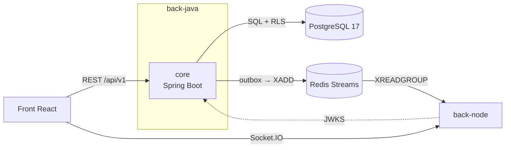
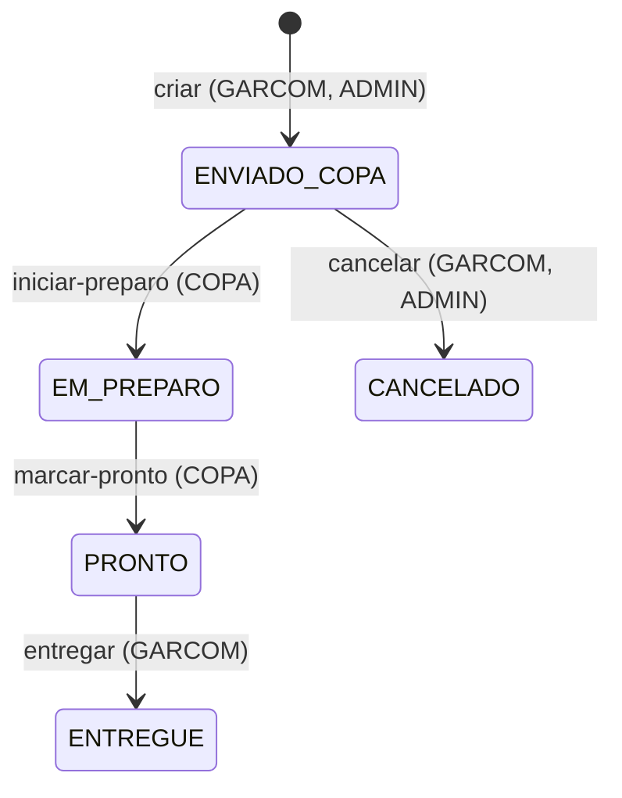
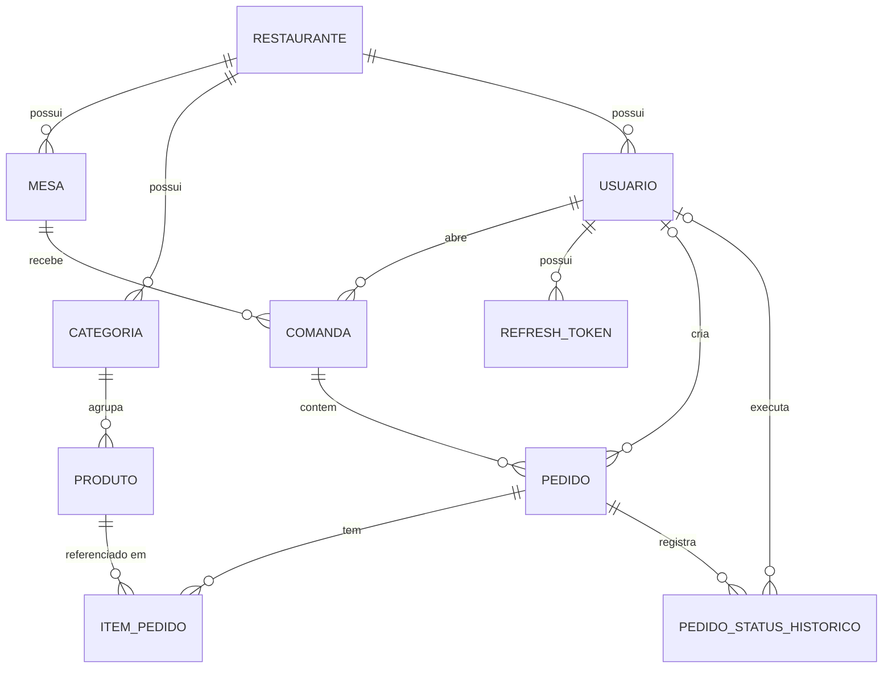

# QuickOrder — back-java

Core do **QuickOrder**, sistema web para restaurantes que reduz gargalos no atendimento com
gestão de mesas, comandas e pedidos em tempo real.

Este repositório é o **dono do estado de negócio**: autenticação, usuários, mesas, cardápio,
comandas e pedidos. O [`back-node`](../back-node) só recebe eventos e notifica as telas; nunca
altera status de pedido.

> **Estado atual:** base do projeto (estrutura, configuração, contrato da API, migration inicial
> e Docker). As regras de negócio ainda não foram implementadas: cada pacote tem só o
> `package-info.java` descrevendo a sua responsabilidade.

## Sumário

- [Arquitetura](#arquitetura)
- [Stack](#stack)
- [Estrutura do repositório](#estrutura-do-repositório)
- [Módulos do core](#módulos-do-core)
- [Como rodar](#como-rodar)
- [Variáveis de ambiente](#variáveis-de-ambiente)
- [Banco de dados e multi-tenancy](#banco-de-dados-e-multi-tenancy)
- [Contrato da API](#contrato-da-api)
- [Eventos e tempo real](#eventos-e-tempo-real)
- [Segurança](#segurança)
- [Observabilidade](#observabilidade)
- [Convenções](#convenções)
- [CI/CD e deploy](#cicd-e-deploy)
- [Próximos passos](#próximos-passos)
- [Documentação](#documentação)

## Arquitetura



- **Monolito modular** com **DDD tático e hexagonal (portas e adaptadores)** em cada módulo.
  Microsserviços só quando houver motivo concreto (escala, time ou deploy independentes).
- **PostgreSQL é a fonte da verdade.** Mudanças de estado gravam o evento na tabela `outbox`
  na mesma transação; um publicador único envia ao Redis Streams depois do commit.
- **Eventos são dicas**: o front sempre reconcilia o estado pelo REST ao conectar e reconectar.
- **Multi-tenant desde o início** (coluna `restaurante_id`), com isolamento garantido por
  **Row-Level Security** no PostgreSQL.
- Gateway (Spring Cloud Gateway) fica para a fase paga; entrará como módulo `gateway` deste
  repositório, por isso o POM pai já é multi-módulo.

## Stack

| Item | Versão |
|---|---|
| Java | 25 (LTS) |
| Spring Boot | 4.1.1 (Web MVC, Security, OAuth2 Resource Server, Data JPA, Data Redis, Actuator, Validation) |
| Banco | PostgreSQL 17 |
| Migrations | Flyway |
| Eventos | Redis 7 (Streams) |
| Build | Maven 3.9 (multi-módulo) |
| Contrato | OpenAPI 3.1 (modular) |
| Container | Docker, Eclipse Temurin 25 (JRE) |

## Estrutura do repositório

```text
back-java/
├── pom.xml                      POM pai (packaging pom); hoje só com o módulo core
├── core/
│   ├── pom.xml
│   ├── Dockerfile               build multi-stage, jar em camadas, usuário não-root
│   └── src/
│       ├── main/java/com/quickorder/restaurant/core/
│       │   ├── QuickOrderApplication.java
│       │   ├── shared/          tenant, erros, eventos, web, segurança
│       │   ├── equipe/          login, JWT, usuários e papéis
│       │   ├── mesa/            mesas e status
│       │   ├── cardapio/        categorias, produtos, cardápio público
│       │   └── comanda/         comandas, pedidos e itens
│       ├── main/resources/
│       │   ├── application.yml
│       │   └── db/migration/    migrations Flyway (V1__schema_inicial.sql)
│       └── test/java/...
├── api/                         contrato OpenAPI 3.1 (entrada: api/openapi.yaml)
│   ├── paths/
│   └── components/{schemas,parameters,responses,headers}.yaml
├── docs/
│   ├── arquitetura.md           decisões de arquitetura e setup
│   └── events/                  contrato dos eventos (Redis Streams / Socket.IO)
├── infra/db/
│   ├── bootstrap.sql            cria o papel restrito da aplicação (ambientes reais)
│   └── bootstrap-dev.sql        o mesmo para dev local e testes
├── docker-compose.yml           PostgreSQL, Redis e core; cria a rede "quickorder"
└── .env.example
```

## Módulos do core

Cada módulo de negócio é dividido em quatro camadas:

| Camada | Conteúdo | Depende de |
|---|---|---|
| `domain/` | entidades, value objects, regras e portas (interfaces) | nada de framework |
| `application/` | casos de uso (`@Transactional`) | `domain` |
| `infrastructure/` | adaptadores: JPA, Redis, clientes externos | `domain`, `application` |
| `web/` | controllers e DTOs (implementam as interfaces geradas do OpenAPI) | `application` |

| Módulo | Responsabilidade |
|---|---|
| `shared` | `TenantContext` e aplicação do tenant por transação, Problem Details (RFC 9457), outbox e publicação de eventos, `correlationId`, `ClientIpResolver`, CORS, segurança |
| `equipe` | usuários, papéis (`ADMIN`, `GARCOM`, `COPA`), login, emissão de JWT RS256, JWKS, refresh token com rotação e detecção de reuso |
| `mesa` | cadastro de mesas; status `LIVRE`/`OCUPADA` derivado da comanda aberta |
| `cardapio` | categorias, produtos, disponibilidade e cardápio público por slug |
| `comanda` | abertura, fechamento e transferência de comanda; pedidos e seu ciclo de vida |

Ciclo de vida do pedido (o status existe só no pedido, não nos itens):



- Novos itens depois do envio viram um novo pedido (rodada).
- Fechar a comanda exige todos os pedidos em `ENTREGUE` ou `CANCELADO`.
- Criar pedido, fechar e transferir comanda travam a comanda (`SELECT ... FOR UPDATE`),
  sempre na ordem comanda → pedidos.
- Só pode existir uma comanda aberta por mesa (índice único parcial).

## Como rodar

### Pré-requisitos

- Docker com Docker Compose v2.
- Para rodar fora do Docker: JDK 25 e Maven 3.9+.

### Tudo com Docker

```bash
cp .env.example .env            # opcional: os padrões já servem para desenvolvimento
docker compose up -d --build
curl http://localhost:8080/actuator/health
```

Sobe:

| Serviço | Porta | Observação |
|---|---|---|
| `postgres` | 5432 | roda `infra/db/bootstrap-dev.sql` na primeira subida do volume |
| `redis` | 6379 | só memória |
| `core` | 8080 | aplica as migrations com Flyway na subida |

Comandos úteis:

```bash
docker compose up -d postgres redis   # só a infraestrutura (para rodar o core pela IDE)
docker compose logs -f core
docker compose down                   # para os containers
docker compose down -v                # para e apaga o banco (recria do zero na próxima subida)
```

O compose cria a rede Docker `quickorder`, usada pelo `back-node` para alcançar o Redis e o core.

### Core fora do Docker

Com a infraestrutura de pé (`docker compose up -d postgres redis`):

```bash
mvn -pl core -am spring-boot:run
```

Os padrões do `application.yml` já apontam para `localhost`.

### Build e testes

```bash
mvn -B verify                                        # compila e roda os testes
docker build -f core/Dockerfile -t quickorder-core:local .
```

## Variáveis de ambiente

Lidas pelo core (`core/src/main/resources/application.yml`). Os padrões servem **só** para
desenvolvimento local.

| Variável | Padrão | Descrição |
|---|---|---|
| `DB_URL` | `jdbc:postgresql://localhost:5432/quickorder` | URL JDBC do banco |
| `DB_APP_USER` | `quickorder_app` | papel restrito usado pela aplicação |
| `DB_APP_PASSWORD` | `quickorder_app_dev` | senha do papel restrito |
| `DB_MIGRATION_USER` | `quickorder` | dono do schema, usado só pelo Flyway |
| `DB_MIGRATION_PASSWORD` | `quickorder` | senha do dono do schema |
| `DB_POOL_SIZE` | `5` | tamanho do pool Hikari |
| `REDIS_URL` | `redis://localhost:6379` | Redis (Streams) |
| `PORT` | `8080` | porta HTTP |

Usadas só pelo `docker-compose.yml`: `POSTGRES_DB`, `POSTGRES_USER`, `POSTGRES_PASSWORD`,
`POSTGRES_PORT`, `REDIS_PORT`, `CORE_PORT` (veja `.env.example`).

O `.env` não é versionado. Nenhum segredo real deve entrar no repositório.

## Banco de dados e multi-tenancy

### Modelo de dados

Relacionamentos da migration `V1__schema_inicial.sql`. Toda tabela, exceto `restaurante`, tem
`restaurante_id`, e as FKs entre tabelas de negócio são compostas (`restaurante_id`, `id`), o que
impede referenciar uma linha de outro restaurante.



- `login` é único por restaurante (`restaurante_id`, `login`).
- Uma comanda aberta por mesa (índice único parcial `uq_comanda_mesa_aberta`).
- `pedido.criado_por` é opcional porque um pedido de origem `CLIENTE` (futuro) não tem usuário.
- `item_pedido` guarda cópia de `nome_produto` e `preco_unitario`; `subtotal` é coluna gerada.
- Tabelas técnicas fora do diagrama: `outbox` (eventos a publicar) e `idempotency_key`
  (chaves de criação de pedido, com referência opcional ao pedido criado).

### Isolamento por tenant

- Toda tabela de negócio tem `restaurante_id` e **RLS** ligado. A policy compara a coluna com
  `nullif(current_setting('app.tenant_id', true), '')::uuid`: sem tenant definido, nenhuma linha
  aparece e nenhum insert passa (falha fechada).
- O tenant é definido **por transação** com `set_config('app.tenant_id', ..., true)` no início
  de cada transação; por isso `spring.jpa.open-in-view=false` e todo caso de uso é
  `@Transactional`. O tenant vem sempre do JWT, nunca de header ou parâmetro.
- Dois papéis no PostgreSQL:
  - **dono do schema** (`DB_MIGRATION_USER`): usado só pelo Flyway;
  - **`quickorder_app`** (`DB_APP_USER`): usado pela aplicação; não é superusuário, não tem
    `BYPASSRLS` e não é dono das tabelas, então o RLS vale de verdade.
- O papel restrito é do cluster e por isso é criado fora das migrations:
  - dev e testes: `infra/db/bootstrap-dev.sql` (executado automaticamente pelo compose);
  - ambientes reais: `psql "$DATABASE_URL" -v app_password='<senha>' -f infra/db/bootstrap.sql`,
    antes da primeira migration.
- Categorias de tabela na V1:
  - **com RLS**: `usuario`, `mesa`, `categoria`, `produto`, `comanda`, `pedido`, `item_pedido`,
    `pedido_status_historico`;
  - **registro, sem RLS**: `restaurante` (resolve o tenant por slug no login e no cardápio público);
  - **técnicas, sem RLS**: `refresh_token`, `outbox`, `idempotency_key`.
- Valores monetários em `NUMERIC(12,2)`; o preço é copiado para o item no momento do pedido.
- Migrations novas: `core/src/main/resources/db/migration/V{n}__descricao.sql`. Nunca altere
  uma migration já aplicada.

## Contrato da API

- **Contract-first**: [`api/openapi.yaml`](api/openapi.yaml), OpenAPI 3.1, dividido em `paths/` e
  `components/`. Os controllers vão implementar as interfaces geradas pelo `openapi-generator`.
- Prefixo `/api/v1`. Mudança aditiva fica na v1; mudança incompatível vira v2.
- IDs públicos em UUID; datas ISO-8601 em UTC; JSON em camelCase; enums em MAIÚSCULAS.
- Dinheiro como **string decimal** (`"12.50"`); totais sempre calculados no servidor.
- Erros em **RFC 9457** (`application/problem+json`) com `code` estável, `correlationId` e
  `errors[]`.
- `X-Correlation-Id` aceito e devolvido em todas as respostas.
- `Idempotency-Key` (UUID) obrigatório em `POST /comandas/{id}/pedidos`.
- Papéis exigidos por operação documentados na extensão `x-roles`.

Para validar e empacotar o contrato:

```bash
npx @redocly/cli lint api/openapi.yaml
npx @redocly/cli bundle api/openapi.yaml -o openapi.bundle.yaml
```

| Área | Endpoints |
|---|---|
| Auth | `POST /auth/login`, `/auth/refresh`, `/auth/logout` |
| Usuários (ADMIN) | `/usuarios`, `/usuarios/{id}`, `/usuarios/{id}/desativar`, `/usuarios/{id}/ativar` |
| Mesas | `/mesas`, `/mesas/{id}` |
| Cardápio (ADMIN) | `/categorias`, `/produtos`, `/produtos/{id}/disponibilidade` |
| Cardápio público | `GET /cardapio/{slug}` (sem autenticação) |
| Comandas | `/comandas`, `/comandas/{id}`, `/comandas/{id}/fechar`, `/comandas/{id}/transferir-mesa` |
| Pedidos | `POST /comandas/{id}/pedidos`, `GET /pedidos`, `/pedidos/{id}` e as ações `iniciar-preparo`, `marcar-pronto`, `entregar`, `cancelar` |

## Eventos e tempo real

Contrato completo em [`docs/events`](docs/events/README.md).

- Streams `events:pedido` e `events:mesa`, consumer group `realtime` (no `back-node`).
- Envelope: `eventId`, `tipo`, `schemaVersion`, `tenantId`, `payload`; mudanças só aditivas.
- Eventos: `pedido.enviado`, `pedido.em_preparo`, `pedido.pronto`, `pedido.entregue`,
  `pedido.cancelado`, `mesa.status_alterado`.
- O payload de pedido leva `pedidoVersion` (do `@Version`), para o front descartar evento antigo.

## Segurança

- Login com usuário e senha (hash BCrypt ou Argon2id) e rate limit.
- Access token **JWT RS256** curto (~15 min) com `sub`, `roles` e `tenant_id`. A chave pública é
  exposta em `/.well-known/jwks.json` para o `back-node` validar localmente.
- Refresh token opaco, com rotação e detecção de reuso.
- Chave privada do JWT sempre fora do repositório.
- **Estado atual:** a `SecurityConfig` nega todas as rotas, exceto `/actuator/health` e
  `/actuator/info`, até o módulo `equipe` implementar a validação do JWT.

## Observabilidade

- `GET /actuator/health` (com probes `liveness` e `readiness`), `/actuator/info` e
  `/actuator/prometheus`. Nenhum outro endpoint do Actuator é exposto.
- Logs JSON com `correlationId` e `tenant_id` (o compose já liga o formato estruturado).

## Convenções

- Branch `main` protegida, PR obrigatório, squash merge e histórico linear.
- Commits em [Conventional Commits](https://www.conventionalcommits.org/pt-br/)
  (`feat:`, `fix:`, `docs:`, `chore:`...).
- Configuração só por variável de ambiente (12-factor); `.env.example` versionado.
- Finais de linha LF (`.gitattributes`) e `.editorconfig` para todos os editores.

## CI/CD e deploy

Planejado (ainda não implementado neste repositório), conforme `docs/arquitetura.md`:

- **CI (GitHub Actions)** em PR e push na `main`: Temurin 25 com cache Maven,
  `./mvnw -B -ntp spotless:check verify`, relatórios de teste e cobertura, Spectral e oasdiff no
  contrato, Trivy na imagem e revisão de dependências.
- **CD**: imagem `linux/amd64` publicada no GHCR com a tag do SHA e deploy no Render por deploy
  hook; verificação pós-deploy no `/actuator/health`.

## Próximos passos

- [ ] Maven Wrapper (`mvn wrapper:wrapper`; depois `git update-index --chmod=+x mvnw`).
- [ ] Pipeline de CI no GitHub Actions.
- [ ] Base do `shared`: Problem Details, `correlationId`, `TenantContext` e `set_config` por
      transação, CORS, `ClientIpResolver`.
- [ ] Testes de integração com Testcontainers, incluindo o **teste de isolamento entre tenants**
      rodando com o papel restrito.
- [ ] Spring Modulith para verificar as fronteiras dos módulos.
- [ ] Geração das interfaces a partir do OpenAPI.
- [ ] `render.yaml` e pipeline de deploy.
- [ ] AOT cache do JDK 25 para reduzir o cold start.

## Documentação

- [`docs/arquitetura.md`](docs/arquitetura.md): todas as decisões de arquitetura e setup.
- [`docs/events`](docs/events/README.md): contrato dos eventos.
- [`api/openapi.yaml`](api/openapi.yaml): contrato HTTP.
- [`back-node`](../back-node): serviço de tempo real.
